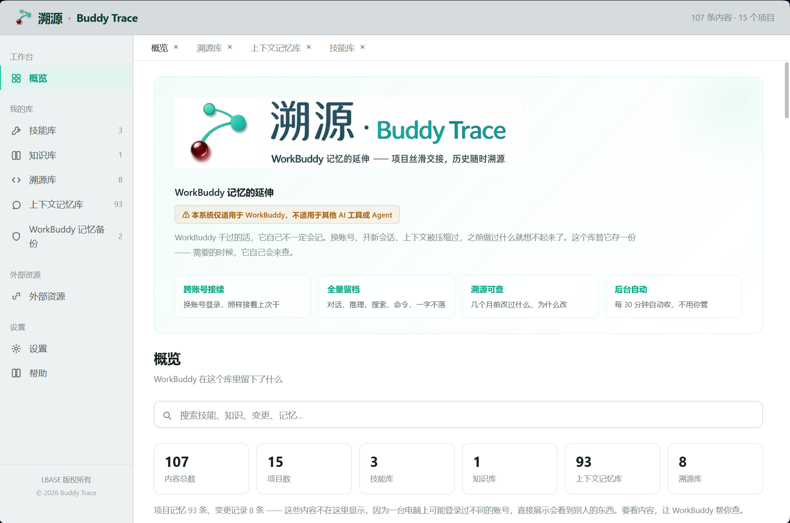
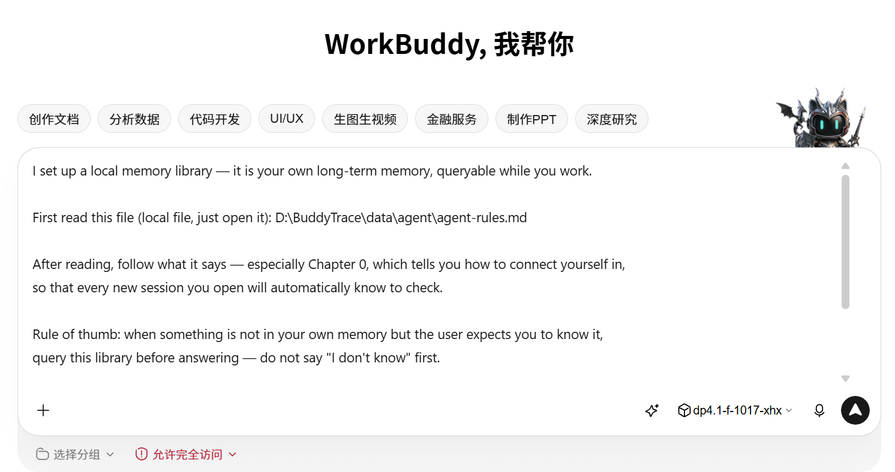

# 溯源 · Buddy Trace

**WorkBuddy 的长期记忆** —— 工作当中随时可查，不用等谁提醒。

换账号、开新会话、聊久了、上下文被压缩过，WorkBuddy 之前做过什么就想不起来了。Buddy Trace 把散落在磁盘上的记忆收进一个本地库，需要的时候，它自己会来查。

> **不迁移会话，不复制副本。**
> 换 WorkBuddy 账号后，老对话的记忆照样接得上——但你的会话始终是原生那一份，
> 不会被搬到别处、也不会变成两份互相打架的拷贝。记忆只有一份，越用越清，不会越用越乱。

> 本软件**仅适用于 WorkBuddy**，不适用于其他 AI 工具或 Agent。

- 官网：https://buddy-trace.lbase.com
- 更新日志：[CHANGELOG.md](CHANGELOG.md)
- macOS 安装：[docs/安装说明-Mac.md](docs/安装说明-Mac.md)

---

## 为什么需要它

WorkBuddy 干过的事，它自己不一定记得。Buddy Trace 解决四个「用不上」：

| 场景 | 没有它 | 有了它 |
|---|---|---|
| **跨会话** | 新会话不知道老会话干过什么 | 说一句「继续做那个项目」，它查上次做到哪，接着干 |
| **跨账号** | 换账号 = 换目录，物理隔离 | 所有账号的记录合并可查，不用管在哪个账号里 |
| **跨项目 / 跨时间** | 三个月前别的项目做过类似的，不知道去哪找 | 一套索引，按项目、按关键词都能查 |
| **「为什么」** | 只记改了哪些文件，当时的推理埋在几千行日志里 | 几个月前的改动和当时的推理都能追溯 |

一句话定位：**不是让 WorkBuddy 变聪明（实时增强），是让它的记忆不再「用不上」。**

## 老会话太贵？直接换新会话

一个会话聊久了，上下文越堆越长，每次对话都要把这一大段重新带上——积分/token 消耗会越来越大。到一定程度，最划算的做法就是**开个新会话**。

问题是：新会话不知道之前做过什么，你得重新交代一遍背景。

Buddy Trace 让这一步变轻：**换新会话，什么都不用交代，说一句「继续做那个项目」就行。** 之前搜了什么、改了什么、为什么改，它自己从记忆库里查。


<em>界面示例｜数据以你本机为准。以上只是说明「长会话消耗会累积」这一现象，数字不代表任何默认值或普遍水平。</em>

## 它做什么

记住四件事就够了：

1. **换号继续** —— 换个账号，说一句「继续做那个项目」，新账号自己找到上次做到哪，接着干。
2. **会话可查** —— 开新会话后，能直接问它搜了什么、跑了什么命令，记录随时查得到。
3. **本地留存** —— 完整记录留在本地库，上下文被压缩后也能查。
4. **改动溯源** —— 几个月前的改动、当时的推理过程都能追溯。

边界（一直不变）：**不迁移会话，不复制副本。**

## 界面



<em>界面示例｜数据以你本机为准。截图显示的是开发者本机的真实统计，不代表任何默认数量；你的内容可能多也可能少。</em>

装好后，在 WorkBuddy 里发一句话接入（设置页可一键复制）：



## 特性

- **免费 · 免注册、免登录**：装完即用，不收费
- **本地部署**：数据全在你自己的电脑上，不上传任何云端
- **只读不改**：对 WorkBuddy 只读取，一个字都不改
- **不迁会话**：只建索引，不搬家、不复制，不会留下多份互相打架的副本
- **后台自动**：每 30 分钟自动收录，不用管；守护进程每 30 分钟体检，卡死自动恢复
- **跨账号**：一台电脑上所有账号的记录合并可查
- **加密迁移**（3.0+）：设一个口令，把整个记忆库加密成一个文件，换电脑导入即恢复；口令不落盘，导入前自动做安全备份
- **稳定不卡**（3.0.4+）：扫描放进独立线程，打开网页不再被后台扫描挡住

## 和同类工具的区别

市面上有给 WorkBuddy 做增强的工具，路子不同。我们做这个选择，理由是实测过的：

| | Buddy Trace | 常见做法 |
|---|---|---|
| 解决什么 | **记忆连续性**：记忆在，换个账号也接得上 | 操作连续性：把会话搬到另一个账号 |
| 会话怎么处理 | 原生那一份，**不迁移、不复制** | 复制会话到新账号 |
| 结果 | 记忆只有一份，越用越清 | 多份副本，容易出现互相打架、越用越乱 |
| 对 WorkBuddy | **只读**，不改它的任何文件 | 有的会注入进程、改写配置 |
| 数据在哪 | 只在你自己的电脑，不上云 | 视工具而定 |

我们**不做**：多账号额度聚合、CDP 注入、遥测上报。知识库用不用是个人选择，这里只说明我们的取舍。

## 快速开始

### Windows 安装包

1. 从官网下载安装包（Gitee Release / 夸克网盘，GitHub Release 见说明）
2. 双击安装，桌面出现「溯源 · Buddy Trace」图标
3. 打开后按引导做一次接入：复制那句引导语 → 发给 WorkBuddy
4. 之后每 30 分钟自动收录；接入只需这一次，以后版本更新自动生效

### macOS / Linux

一条命令安装（详见 [docs/安装说明-Mac.md](docs/安装说明-Mac.md)）：

```bash
curl -fsSL "https://gitee.com/gaogao2013/Buddy-Trace/raw/master/scripts/install-mac.sh" -o /tmp/bt-install.sh && bash /tmp/bt-install.sh
```

前提：Node.js 22+。升级 = 重跑同一条命令。

### 源码运行

要求：Node.js 22+（读 WorkBuddy 数据需要 Node 22 内置的 sqlite）。

```bash
git clone https://github.com/gaoggao/Buddy-Trace.git
cd Buddy-Trace
node src/index.js
# 浏览器打开 http://127.0.0.1:41829
```

数据目录默认在程序旁边的 `data/`，可用 `--data` 指定。端口占用会自动换（41829/41830/41831）。

## 隐私

- 对 WorkBuddy **只读**：不改动它的任何文件和目录
- 数据只在你本地，不上传；没有账号、没有遥测
- 唯一的对外请求：安装完成时的匿名计数（随机 ID + 版本 + 系统类型，无 IP / 电脑名 / 任何内容），可在防火墙拦截，不影响使用

## 已知边界

- 仅适用于 WorkBuddy；手机 App 的会话在云端，本地磁盘没有，查不到
- 产出物本身（视频、报告、代码文件）不在库里，在工作区目录
- Mac 版不参与 Windows 的 exe 增量更新，升级靠重跑安装命令

## 项目结构

```
src/                    后端服务（Node.js，零第三方依赖）
  shell.js              启动器（exe 入口，优先加载外部 code，缺失则用内置兜底）
  index.js              启动入口
  server.js             HTTP 服务层（全部 API）
  store.js              存储层（本地库）
  scan-worker.js        同步扫描（独立线程，不挡服务）
  service-log.js        服务日志
  wb-sync.js            WorkBuddy 数据同步
  wb-syncer.js          定时同步器
  wb-guide.js           给 agent 的接入说明生成
  wb-extract.js         WorkBuddy 数据提取
  wb-privacy.js         隐私脱敏
  wb-export.js          导出
  migration.js          加密迁移（导出/导入）
  updater.js            增量更新（下载/校验/备份/覆盖/回滚）
  runtime.js            运行状态（runtime.json + 单实例检查）
  ports.js / version.js 端口 / 版本号（统一来源）
  help-data.js          帮助文档数据

public/                 前端界面（index.html + ui/app.js + ui/app.css）
scripts/                构建和部署脚本
  build-exe.js          打包 exe 壳 + 增量代码包
  embed-ui.js           内嵌前端资源到 src/assets.js
  install-mac.sh        macOS 安装 / 升级（开机自启、数据备份）
  uninstall-mac.sh      macOS 卸载
  wb-watchdog.js        Windows 守护脚本
  run-hidden.vbs        Windows 静默启动 + 健康探测

docs/                   使用文档与截图
installer.iss           Windows 安装包脚本（Inno Setup）
CHANGELOG.md            更新日志
```

## 更新日志

版本记录见 [CHANGELOG.md](CHANGELOG.md)。

## 许可与免责声明

许可详见 [LICENSE](LICENSE)。

本软件是 WorkBuddy 记忆的辅助工具，仅供参考，不保证数据完整、准确，因使用造成的损失作者不承担责任。
